<a href="https://www.linkedin.com/in/alissonkaipers/"><picture><source media="(prefers-color-scheme: dark)" srcset="./cards/hero-dark.svg"></picture></a>

<picture><source media="(prefers-color-scheme: dark)" srcset="./cards/bloco-1-dark.svg"></picture>
<picture><source media="(prefers-color-scheme: dark)" srcset="./cards/bloco-2-dark.svg"></picture>
<picture><source media="(prefers-color-scheme: dark)" srcset="./cards/bloco-3-dark.svg"></picture>

<picture><source media="(prefers-color-scheme: dark)" srcset="./cards/tecnologias-dark.svg"></picture>

<picture><source media="(prefers-color-scheme: dark)" srcset="./cards/formacao-dark.svg"></picture>

<a href="https://www.linkedin.com/in/alissonkaipers/"><picture><source media="(prefers-color-scheme: dark)" srcset="./cards/linkedin-dark.svg"></picture></a>
<a href="mailto:alissonkaipers@gmail.com"><picture><source media="(prefers-color-scheme: dark)" srcset="./cards/email-dark.svg"></picture></a>

